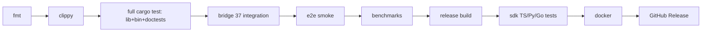

# Sisyphus Project Dashboard

> **Auto-generated at:** 2026-07-31
> **Commits:** 130+
> **Workspace:** 21 crates + webui
> **Tests:** 1261 passing, 0 failing, 0 ignored

## Crate Health

| Crate | Status | Tests | Key Metrics |
|-------|--------|-------|-------------|
| **sisyphus-core** | ✅ Production | 87 | Cognitive loop v1+v2, DAG executor |
| **sisyphus-bridge** | ✅ Production | 37 integration | gRPC (17 RPCs) + REST (34 endpoints) |
| **sisyphus-cli** | ✅ Production | 52 | clap CLI + ratatui TUI (lib + bin) |
| **sisyphus-types** | ✅ Production | 29 | Config, traits, shared types |
| **sisyphus-webui** | ✅ Production | - | axum + HTMX + SSE dashboard |
| **sisyphus-sandbox** | ✅ Production | - | wasmtime + fuel + memory limits |
| **sisyphus-sandboxd** | ✅ Production | 6 | stdio + gRPC dual-mode daemon |
| **sisyphus-mem** | ✅ Production | - | L1 (DashMap) + L2 (SQLite) + Vector |
| **sisyphus-intel** | ✅ Production | 121 | Simulation, synthesis, planners |
| **sisyphus-api** | ✅ Production | 6 | REST API models (roundtrip) |
| **sisyphus-sdk** | ✅ Production | 10 | Rust SDK client + models |
| **sisyphus-tools-*** (10) | ✅ Production | - | 40+ tool modules |
| **sisyphus-tests** | ✅ Production | - | E2E cross-project integration |

## CI Pipeline (Full Coverage)



## Quality Gates

| Gate | Status | Detail |
|------|--------|--------|
| `cargo fmt --check` | ✅ | Passes cleanly |
| `cargo clippy -D warnings` | ✅ | All crates clean |
| `cargo test --workspace` | ✅ | **1261 tests pass** (lib + bin + doctests) |
| SDK TypeScript | ✅ | 14 tests pass |
| SDK Python | ✅ | 21 tests pass |
| SDK Go | ✅ | 13 tests pass |
| Rust API+SDK | ✅ | 16 tests pass (api 6 + sdk 10) |

## Infrastructure

| Component | Status | Detail |
|-----------|--------|--------|
| **Docker** | ✅ | Multi-stage build, docker-compose |
| **Nightly CI** | ✅ | GHCR + multi-platform |
| **Release CI** | ✅ | upload-artifact + gh-release files |
| **IDE Plugins** | ✅ | VSCode 640 lines + Zed 395 lines |
| **REST API** | ✅ | 34 endpoints, OpenAPI 3.1 spec, `{id}` syntax |

## Cognitive Loop Maturity

```
v1: Predict → Execute → Reflect → Evolve  [PRODUCTION]
v2: + AdaptiveDepthController              [INTEGRATED]
    + AnomalyDetector                      [INTEGRATED]
    + ParallelBranchPredictor              [INTEGRATED]
    + Simulation-based verification        [INTEGRATED]
```

## Key ADRs

| ADR | Decision | Status |
|-----|----------|--------|
| ADR-002 | Multi-agent team architecture | ✅ Accepted |
| ADR-003 | Monolithic-to-modular restructure | ✅ Accepted |
| ADR-004 | Workspace isolation strategy | ✅ Accepted |
| ADR-005 | Sandboxd daemon architecture | ✅ Accepted |
| ADR-006 | Configuration system (TOML + env) | ✅ Accepted |

## Getting Started

```bash
# Build and run
make check-all
cargo run -p sisyphus-bridge    # gRPC + REST
cargo run -p sisyphus-cli -i    # TUI

# Test (full workspace, ~3 min)
cargo test --workspace
```

## Next Development Areas

- **REST API endpoint coverage**: Add missing gRPC → HTTP mappings
- **Sandboxd cluster mode**: Multi-daemon pool for concurrent WASM
- **Multi-architecture builds**: ARM64 Linux, macOS x86_64
- **Otel/distributed tracing**: Replace Prometheus-only with OpenTelemetry
