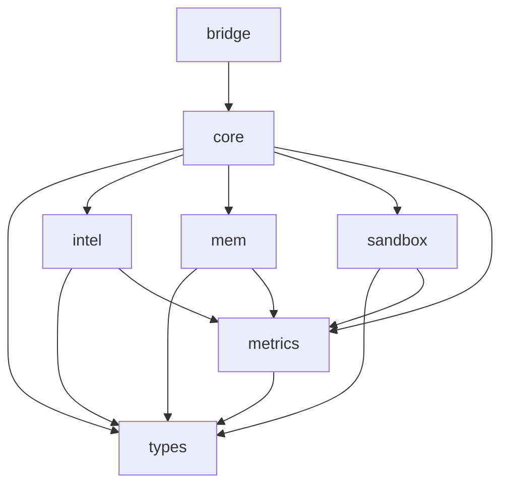

# Architecture Overview

Sisyphus is organized as a **Rust workspace** with seven interdependent crates, each responsible for a distinct concern:

```
┌─────────────────────────────────────────────────┐
│                   sisyphus-bridge                 │
│           HTTP/gRPC API · Entry Points            │
├─────────────────────────────────────────────────┤
│                   sisyphus-core                   │
│        Kernel · Orchestration · Cognitive Loop    │
├────────┬────────┬────────┬────────┬──────────────┤
│  types  │  intel  │   mem   │ sandbox │  metrics   │
│   datatypes │cognition│storage  │WASM run │ observability│
└────────┴────────┴────────┴────────┴──────────────┘
```

## Dependency Flow



## Data Flow (Cognitive Cycle)

```
         ┌──────────┐
         │  GOAL    │
         └────┬─────┘
              ▼
     ┌────────────────┐
     │   Synthesize    │  sisyphus-intel
     │   SOP from goal │
     └───────┬────────┘
              ▼
     ┌────────────────┐
     │  Execute SOP   │  sisyphus-core (DAG runner)
     │  (parallel)    │  sisyphus-sandbox (WASM tools)
     └───────┬────────┘
              ▼
     ┌────────────────┐
     │   Simulate     │  sisyphus-intel (Monte Carlo)
     │   Outcomes     │
     └───────┬────────┘
              ▼
     ┌────────────────┐
     │   Reflect      │  sisyphus-intel (deviation)
     │   Compare      │
     └───────┬────────┘
              ▼
     ┌────────────────┐
     │   Evolve SOP   │  sisyphus-intel (mutate)
     │   or Converge  │
     └───────┬────────┘
              │
      ┌───────┴───────┐
      ▼               ▼
  Converged?      Loop back
      │           to Execute
      ▼
   Return result
```

## Key Design Decisions

- **No `async` in trait methods**: The system uses `async_trait` for trait methods that need async execution.
- **WASM-first tooling**: All external tool code runs in sandboxed WASM instances with fuel and memory limits.
- **Metrics everywhere**: Every significant operation records Prometheus metrics for observability.
- **Two-level cache**: L1 (in-memory `DashMap`) + L2 (SQLite via `sqlx`) for fast key-value storage.

## Architecture Decision Records

Significant architecture decisions are documented as ADRs in [`docs/adr/`](https://github.com/zeronhq/sisyphus-wasm/tree/main/docs/adr):

| ADR | Title | Status |
|-----|-------|--------|
| [ADR-002](https://github.com/zeronhq/sisyphus-wasm/blob/main/docs/adr/002-phase-3b-agent-team-architecture.md) | Phase 3b Multi-Agent Team Architecture | Proposed |
| [ADR-003](https://github.com/zeronhq/sisyphus-wasm/blob/main/docs/adr/003-modular-restructure.md) | Monolithic-to-Modular Restructure | Accepted |
