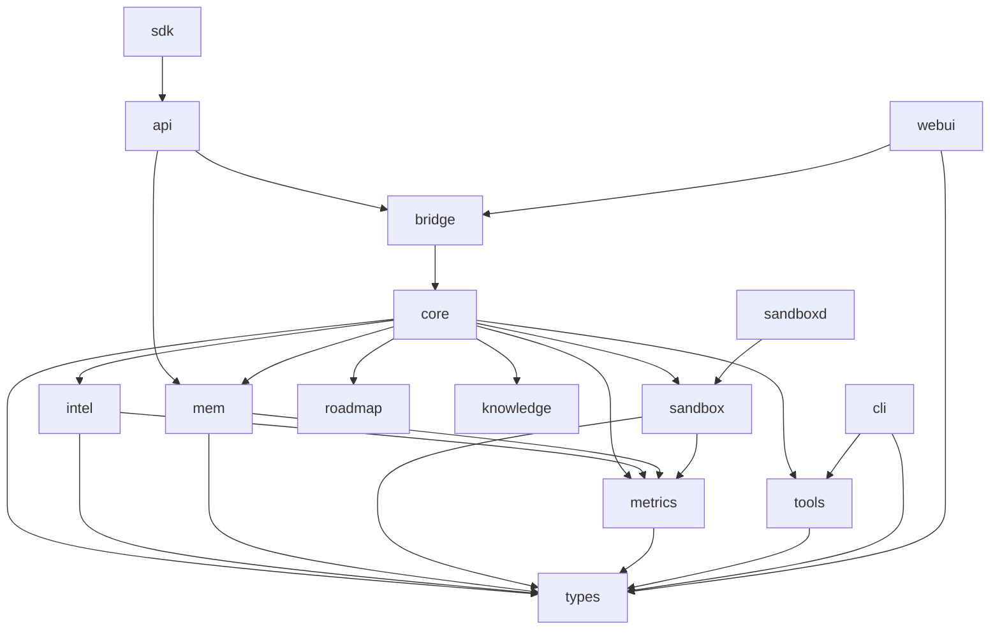

# 架构总览

Sisyphus 以 **Rust 工作区** 组织，包含 **29 个成员**：`crates/` 下的 **27 个 crate**（含 10 个 `sisyphus-tools-*` 子 crate，以及 `webui` 和 `evals`），每个 crate 负责一个明确的关注点：

- `sisyphus-bridge` — 入口点（HTTP/gRPC/REST API；独立 sisyphus-api 已归档至 ide/api）
- `sisyphus-core` — 内核：DAG 执行器、编排、认知循环
- `sisyphus-types` / `sisyphus-intel` / `sisyphus-mem` / `sisyphus-sandbox` / `sisyphus-metrics` — 基础层
- `sisyphus-roadmap` / `sisyphus-knowledge` / `sisyphus-visual` / `sisyphus-tools-*`（10 个）/ `sisyphus-cli` / `webui` — 能力与客户端

## 依赖流向



## 数据流（认知周期）

```
         ┌──────────┐
         │  目标    │
         └────┬─────┘
              ▼
     ┌────────────────┐
     │   合成         │  sisyphus-intel
     │   从目标生成 SOP│
     └───────┬────────┘
              ▼
     ┌────────────────┐
     │ 执行 SOP      │  sisyphus-core (DAG runner)
     │ (并行)        │  sisyphus-sandbox (WASM 工具)
     └───────┬────────┘
              ▼
     ┌────────────────┐
     │   模拟         │  sisyphus-intel (蒙特卡洛)
     │   结果         │
     └───────┬────────┘
              ▼
     ┌────────────────┐
     │   反思         │  sisyphus-intel (偏差)
     │   比较         │
     └───────┬────────┘
              ▼
     ┌────────────────┐
     │ 演进 SOP      │  sisyphus-intel (变异)
     │ 或收敛        │
     └───────┬────────┘
              │
      ┌───────┴───────┐
      ▼               ▼
  已收敛?          循环回
      │           到执行
      ▼
   返回结果
```

## 关键设计决策

- **trait 方法不使用 `async`**：需要异步执行的 trait 方法使用 `async_trait`。
- **WASM 优先的工具**：所有外部工具代码在带燃料与内存限制的沙箱 WASM 实例中运行。
- **处处埋点**：每个重要操作都记录 Prometheus 指标以便观测。
- **两级缓存**：L1（内存 `DashMap`）+ L2（`sqlx` + SQLite）提供快速键值存储。

## 沙箱：嵌入式与守护进程架构

WASM 沙箱有两种运行模式，由 `Config.sandbox.use_sandboxd` 控制：

### 嵌入式模式（`use_sandboxd = false`，默认）

```
┌───────────────┐     ExecuteTool     ┌─────────────────┐
│   gRPC Bridge  │ ──────────────────> │  WasmToolExecutor │
│               │ <────────────────── │  (wasmtime)      │
└───────────────┘     return result   └─────────────────┘
```

- `wasmtime` 在 bridge 进程中内嵌运行。
- 部署简单，无 IPC 开销。
- OOM 风险：cranelift JIT 内存在进程退出前不会释放。
- 适合开发与低吞吐场景。

### 守护进程模式（`use_sandboxd = true`）

```
┌───────────────┐     gRPC (IPC)     ┌──────────────────┐
│   gRPC Bridge  │ ──────────────────> │ sisyphus-sandboxd │
│               │ <────────────────── │  (wasmtime)       │
└───────────────┘     return result   └──────────────────┘
         │                                │
         │ 启动时生成子进程                │ 每次调用独立的 WASM
         │ 退出时回收                    │ 实例生命周期
         ▼                                ▼
   子进程池                       燃料门控执行
```

Bridge 启动时生成 `sisyphus-sandboxd` 作为受管子进程，优雅关闭时回收。通信通过本地 gRPC（tonic）通道进行，守护进程监听 `127.0.0.1:0`（临时端口）。

**优势：**
- 进程级隔离：sandboxd 崩溃不会拖垮 bridge。
- 内存隔离：每次 WASM 调用可在全新的守护进程进程中运行。
- 独立扩展：守护进程可部署在单独的硬件上。
- OOM 缓解：守护进程可在不中断 bridge 的情况下重启。

**配置：**
- `sandboxd_path`：`sisyphus-sandboxd` 二进制路径，默认为 `PATH` 搜索。
- 守护进程通过自己的 gRPC 服务接收 `wasmtime` 执行请求，使用与 `ExecuteTool` 类似的契约。

## 架构决策记录

重要的架构决策以 ADR 形式记录在 `docs/adr/`。完整索引（含状态、日期、编号说明
与反熵链路阅读顺序）见 [`docs/adr/README.md`](https://github.com/zerove/opencodepro/blob/master/docs/adr/README.md)。

| ADR | 标题 | 状态 |
|-----|-------|--------|
| [002](https://github.com/zerove/opencodepro/blob/master/docs/adr/002-phase-3b-agent-team-architecture.md) | 阶段 3b 多代理团队架构 | 提案 |
| [003](https://github.com/zerove/opencodepro/blob/master/docs/adr/003-modular-restructure.md) | 单体到模块化重构 | 已接受 |
| [004](https://github.com/zerove/opencodepro/blob/master/docs/adr/004-workspace-isolation.md) | 多租户工作区隔离 | 已接受 |
| [005](https://github.com/zerove/opencodepro/blob/master/docs/adr/005-sandboxd-daemon-architecture.md) | Sandboxd 守护进程架构 | 已接受 |
| [0005](https://github.com/zerove/opencodepro/blob/master/docs/adr/0005-cognitive-loop-v2.md) | 认知循环 v2（自适应深度 / 分支评估 / 异常检测） | 已修订（分支预测器已移除） |
| [006](https://github.com/zerove/opencodepro/blob/master/docs/adr/006-configuration-system.md) | 配置系统 | 已接受 |
| [007](https://github.com/zerove/opencodepro/blob/master/docs/adr/007-production-grade-standards.md) | 最终产品开发标准 | 已接受 |
| [008](https://github.com/zerove/opencodepro/blob/master/docs/adr/008-shared-http-client.md) | 生产级共享 HTTP 客户端 | 已接受 |
| [009](https://github.com/zerove/opencodepro/blob/master/docs/adr/009-distributed-v2-architecture.md) | 分布式 v2 架构（peer 协议 + CRDT + 共识） | 已实施 |
| [010](https://github.com/zerove/opencodepro/blob/master/docs/adr/010-experience-anti-entropy.md) | 跨节点经验的反熵补偿 | 已实施 |
| [011](https://github.com/zerove/opencodepro/blob/master/docs/adr/011-lagged-catchup-and-digest-holes.md) | 广播 Lagged 的闭合与摘要空洞 | 已实施 |
| [012](https://github.com/zerove/opencodepro/blob/master/docs/adr/012-keyset-pagination-cursor.md) | 反熵分页改用主键游标 | 已接受 |
| [013](https://github.com/zerove/opencodepro/blob/master/docs/adr/013-reuse-catchup-receiver-across-reconnect.md) | 补齐信号跨重连复用接收器 | 已实施 |
| [014](https://github.com/zerove/opencodepro/blob/master/docs/adr/014-break-core-tools-dependency.md) | 解除 core 对 tools-\* 的反向依赖 | 已接受 |

> 编号说明：`0005` 与 `005` 是两份**不同**决策，历史上出现过四位补零写法。
> 为避免已发布链接失效，不重命名；新 ADR 从 `015` 起按三位编号。