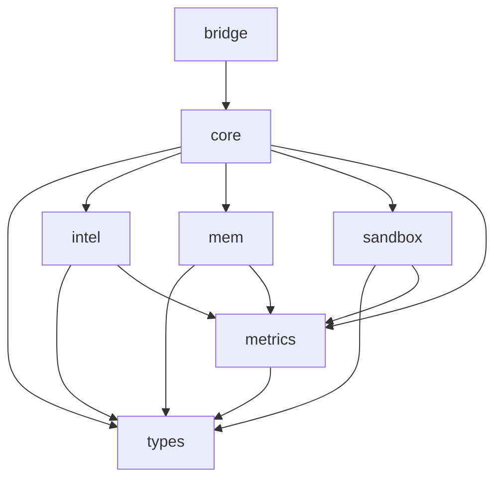

# Architecture Overview

Sisyphus is organized as a **Rust workspace** with seven interdependent crates, each responsible for a distinct concern:

```
┌─────────────────────────────────────────────────┐
│                   sisyphus-bridge                 │
│           HTTP/gRPC API · Entry Points            │
├─────────────────────────────────────────────────┤
│                   sisyphus-core                   │
│        Kernel · Orchestration · Cognitive Loop    │
├────────┬────────┬────────┬────────┬──────────────┤
│  types  │  intel  │   mem   │ sandbox │  metrics   │
│   datatypes │cognition│storage  │WASM run │ observability│
└────────┴────────┴────────┴────────┴──────────────┘
```

## Dependency Flow



## Data Flow (Cognitive Cycle)

```
         ┌──────────┐
         │  GOAL    │
         └────┬─────┘
              ▼
     ┌────────────────┐
     │   Synthesize    │  sisyphus-intel
     │   SOP from goal │
     └───────┬────────┘
              ▼
     ┌────────────────┐
     │  Execute SOP   │  sisyphus-core (DAG runner)
     │  (parallel)    │  sisyphus-sandbox (WASM tools)
     └───────┬────────┘
              ▼
     ┌────────────────┐
     │   Simulate     │  sisyphus-intel (Monte Carlo)
     │   Outcomes     │
     └───────┬────────┘
              ▼
     ┌────────────────┐
     │   Reflect      │  sisyphus-intel (deviation)
     │   Compare      │
     └───────┬────────┘
              ▼
     ┌────────────────┐
     │   Evolve SOP   │  sisyphus-intel (mutate)
     │   or Converge  │
     └───────┬────────┘
              │
      ┌───────┴───────┐
      ▼               ▼
  Converged?      Loop back
      │           to Execute
      ▼
   Return result
```

## Key Design Decisions

- **No `async` in trait methods**: The system uses `async_trait` for trait methods that need async execution.
- **WASM-first tooling**: All external tool code runs in sandboxed WASM instances with fuel and memory limits.
- **Metrics everywhere**: Every significant operation records Prometheus metrics for observability.
- **Two-level cache**: L1 (in-memory `DashMap`) + L2 (SQLite via `sqlx`) for fast key-value storage.

## Sandbox: Embedded vs. Daemon Architecture

The WASM sandbox can operate in two modes, controlled by `Config.sandbox.use_sandboxd`:

### Embedded Mode (`use_sandboxd = false`, default)

```
┌───────────────┐     ExecuteTool     ┌─────────────────┐
│   gRPC Bridge  │ ──────────────────> │  WasmToolExecutor │
│               │ <────────────────── │  (wasmtime)      │
└───────────────┘     return result   └─────────────────┘
```

- `wasmtime` runs in-process in the bridge process.
- Simple deployment, no IPC overhead.
- Risk of OOM: cranelift JIT memory is never freed until process exit.
- Suitable for development and low-throughput scenarios.

### Daemon Mode (`use_sandboxd = true`)

```
┌───────────────┐     gRPC (IPC)     ┌──────────────────┐
│   gRPC Bridge  │ ──────────────────> │ sisyphus-sandboxd │
│               │ <────────────────── │  (wasmtime)       │
└───────────────┘     return result   └──────────────────┘
         │                                │
         │ spawns on start                │ per-call WASM
         │ reaps on exit                  │ instance lifecycle
         ▼                                ▼
   Child process pool            Fuel-gated execution
```

The bridge spawns `sisyphus-sandboxd` as a managed child process on startup and reaps it on graceful shutdown. Communication occurs over a local gRPC (tonic) channel with the daemon listening on `127.0.0.1:0` (ephemeral port).

**Benefits:**
- Process-level isolation: a sandboxd crash does not take down the bridge.
- Memory isolation: each WASM call can run in a fresh daemon process.
- Independent scaling: the daemon can be deployed on separate hardware.
- OOM mitigation: daemon processes can be restarted without bridge downtime.

**Configuration:**
- `sandboxd_path`: Path to `sisyphus-sandboxd` binary, defaults to `PATH` search.
- The daemon accepts `wasmtime` execution requests via its own gRPC service, using the same `ExecuteTool`-like contract.

## Architecture Decision Records

Significant architecture decisions are documented as ADRs in [`docs/adr/`](https://github.com/zeronhq/sisyphus-wasm/tree/main/docs/adr):

| ADR | Title | Status |
|-----|-------|--------|
| [ADR-002](https://github.com/zeronhq/sisyphus-wasm/blob/main/docs/adr/002-phase-3b-agent-team-architecture.md) | Phase 3b Multi-Agent Team Architecture | Proposed |
| [ADR-003](https://github.com/zeronhq/sisyphus-wasm/blob/main/docs/adr/003-modular-restructure.md) | Monolithic-to-Modular Restructure | Accepted |
| [ADR-004](https://github.com/zeronhq/sisyphus-wasm/blob/main/docs/adr/004-workspace-isolation.md) | Multi-tenant Workspace Isolation | Accepted |
| [ADR-005](https://github.com/zeronhq/sisyphus-wasm/blob/main/docs/adr/005-sandboxd-daemon-architecture.md) | Sandboxd Daemon Architecture | Accepted |
| [ADR-006](https://github.com/zeronhq/sisyphus-wasm/blob/main/docs/adr/006-configuration-system.md) | Configuration System | Accepted |
