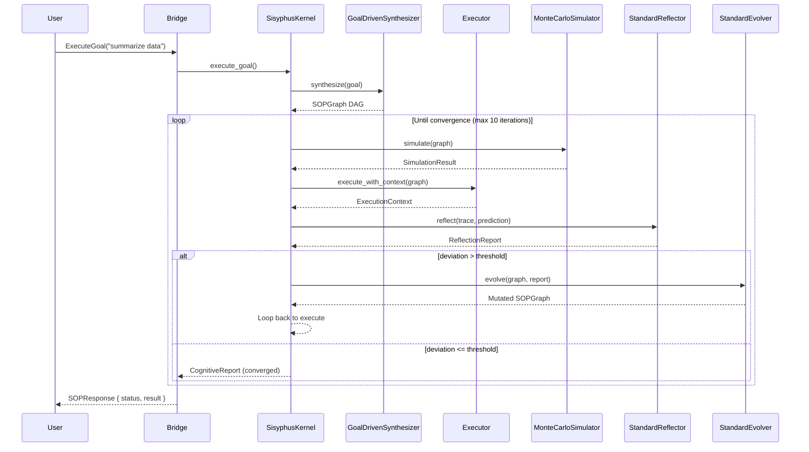

# 认知循环

驱动 Sisyphus 自我改进行为的递归 **OODA 启发** 周期。

## 时序图



## 阶段

```
┌─────────────────────────────────────────────────────┐
│                   合成                                │
│           目标驱动的 SOP 生成                        │
└──────────────────────┬──────────────────────────────┘
                       ▼
┌─────────────────────────────────────────────────────┐
│               ┌───────────┐                          │
│               │  模拟     │ ◄── 蒙特卡洛             │
│               └─────┬─────┘     随机路径采样          │
│                     │                                │
│   ┌─────────────────▼──────────────────────┐         │
│   │             执行                       │         │
│   │     DAG 并行拓扑序执行                  │         │
│   └─────────────────┬──────────────────────┘         │
│                     │                                │
│               ┌─────▼─────┐                          │
│               │  反思     │ ◄── 偏差分数            │
│               └─────┬─────┘                          │
│                     │                                │
│                     │ 偏差 > 阈值?                    │
│                     │                                │
│               ┌─────▼─────┐                          │
│               │  演进     │ ◄── 变异 SOP            │
│               └─────┬─────┘                          │
│                     │                                │
│                     └── 循环 ────────────────────────┘
│                                                     │
│               收敛 → 返回结果                        │
└─────────────────────────────────────────────────────┘
```

## 关键实现：`execute_with_cognition()`

```rust
// 简化为 sisyphus-core
async fn execute_with_cognition(
    &self, graph: &SOPGraph, start: NodeIndex, sop_id: &str, ...
) -> Result<(NodeOutput, String, Option<SOPGraph>), String> {
    let mut current_ref = graph.clone();
    let max_iter = 10;

    for iteration in 0..max_iter {
        // 1. 预测结果
        let prediction = intel.simulator.simulate(&current_ref, &ctx, sop_id).await?;

        // 2. 执行 SOP
        let final_ctx = executor.execute_with_context(&current_ref, start, None).await?;

        // 3. 构建轨迹并反思
        let trace = build_trace(&current_ref, &final_ctx);
        let reflection = intel.reflector.reflect(&trace, &prediction).await?;

        // 4. 检查收敛
        if reflection.deviation_score < CONVERGENCE_THRESHOLD {
            return Ok((result, report, None));  // 完成
        }

        // 5. 演进并重试
        let evolved = intel.evolver.evolve(&current_ref, &reflection, &prediction)?;
        current_ref = evolved;
    }

    Err("Max iterations exceeded".into())
}
```

## 收敛条件

循环在满足以下任一条件时终止：

- **偏差阈值**：`deviation_score < 0.15`（预测与实际匹配）
- **最大迭代**：循环 10 次未收敛
- **无演进**：Evolver 返回结构相同的 `Ok(graph)`（无可改进）