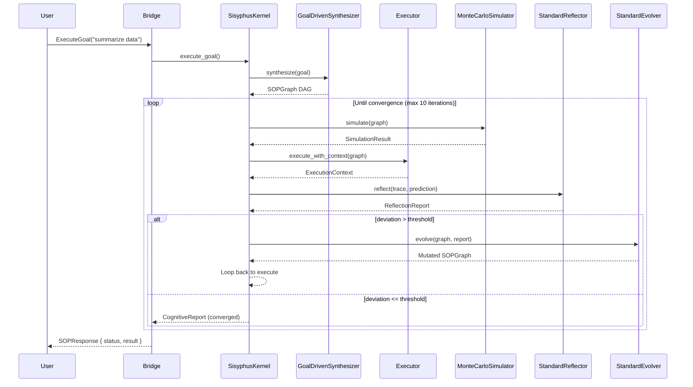

# Cognitive Loop

The recursive **OODA-inspired** cycle that drives Sisyphus's self-improvement behavior.

## Sequence Diagram



## Phases

```
┌─────────────────────────────────────────────────────┐
│                   Synthesis                           │
│           Goal-driven SOP generation                  │
└──────────────────────┬──────────────────────────────┘
                       ▼
┌─────────────────────────────────────────────────────┐
│               ┌───────────┐                          │
│               │ Simulate  │ ◄── Monte Carlo          │
│               └─────┬─────┘     random path sampling │
│                     │                                │
│   ┌─────────────────▼──────────────────────┐         │
│   │             Execute                    │         │
│   │    DAG parallel topological order      │         │
│   └─────────────────┬──────────────────────┘         │
│                     │                                │
│               ┌─────▼─────┐                          │
│               │  Reflect  │ ◄── deviation score      │
│               └─────┬─────┘                          │
│                     │                                │
│                     │ deviation > threshold?         │
│                     │                                │
│               ┌─────▼─────┐                          │
│               │   Evolve   │ ◄── mutate SOP          │
│               └─────┬─────┘                          │
│                     │                                │
│                     └── loop ────────────────────────┘
│                                                     │
│               convergence → return result            │
└─────────────────────────────────────────────────────┘
```

## Key Implementation: `execute_with_cognition()`

```rust
// Simplified from sisyphus-core
async fn execute_with_cognition(
    &self, graph: &SOPGraph, start: NodeIndex, sop_id: &str, ...
) -> Result<(NodeOutput, String, Option<SOPGraph>), String> {
    let mut current_ref = graph.clone();
    let max_iter = 10;

    for iteration in 0..max_iter {
        // 1. Predict outcome
        let prediction = intel.simulator.simulate(&current_ref, &ctx, sop_id).await?;

        // 2. Execute the SOP
        let final_ctx = executor.execute_with_context(&current_ref, start, None).await?;

        // 3. Build trace and reflect
        let trace = build_trace(&current_ref, &final_ctx);
        let reflection = intel.reflector.reflect(&trace, &prediction).await?;

        // 4. Check convergence
        if reflection.deviation_score < CONVERGENCE_THRESHOLD {
            return Ok((result, report, None));  // Done
        }

        // 5. Evolve and retry
        let evolved = intel.evolver.evolve(&current_ref, &reflection, &prediction)?;
        current_ref = evolved;
    }

    Err("Max iterations exceeded".into())
}
```

## Convergence Conditions

The loop terminates when any of:

- **Deviation threshold**: `deviation_score < 0.15` (predictions match actuals)
- **Max iterations**: Loop runs 10 times without converging
- **No evolution**: Evolver returns `Ok(graph)` with identical structure (no changes possible)
