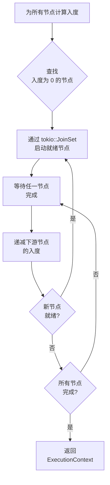

# DAG 执行

Sisyphus 使用基于入度跟踪的**并行拓扑执行器**执行 SOP 图。

## 算法



## 并行模型

无依赖关系的节点同时执行：

```mermaid
gantt
    title DAG 执行时间线
    dateFormat X
    axisFormat %s

    section 批次 1
    Node A (fetch)    : 0, 3
    Node B (validate) : 0, 2
    Node C (search)   : 0, 4

    section 批次 2
    Node D (process)  : 3, 3
    Node E (merge)    : 4, 2

    section 批次 3
    Node F (output)   : 6, 1
```



## 代码：核心执行器

```rust
// 简化为 sisyphus-core::Executor
pub async fn execute_with_context(
    &self, sop_graph: &SOPGraph, start_node: NodeIndex, initial_ctx: Option<Arc<ExecutionContext>>,
) -> Result<Arc<ExecutionContext>, String> {
    // 校验无环
    toposort(&sop_graph.graph, None).map_err(|_| "SOPGraph contains cycles")?;

    let ctx = initial_ctx.unwrap_or_else(|| Arc::new(ExecutionContext::new()));
    let mut join_set = JoinSet::new();
    let mut in_degree: HashMap<NodeIndex, usize> = HashMap::new();

    // 初始化入度计数
    for node in sop_graph.graph.node_indices() {
        let degree = sop_graph.graph.edges_directed(node, Incoming).count();
        in_degree.insert(node, degree);
        if degree == 0 {
            let ctx = ctx.clone();
            let node = sop_graph.graph[node].clone();
            join_set.spawn(async move { node.execute(&ctx).await });
        }
    }

    // 随完成处理结果
    while let Some(result) = join_set.join_next().await {
        let (node_id, output) = result.map_err(|e| format!("Join error: {}", e))??;
        // 在上下文中存储输出
        ctx.set(&sop_graph.graph[node_id].name(), output).await;
        // 扇出到下游节点
        for edge in sop_graph.graph.edges_directed(node_id, Outgoing) {
            let target = edge.target();
            let degree = in_degree.get_mut(&target).unwrap();
            *degree -= 1;
            if *degree == 0 {
                // 启动现在就绪的节点
            }
        }
    }

    Ok(ctx)
}
```

## 错误处理

- **环检测**：`toposort()` 在执行前拒绝环形图
- **节点错误**：向上传播，认知循环捕获并演进 SOP
- **Join 错误**：Tokio 任务 panic 被捕获并作为错误返回

## 燃料与内存

每个节点使用其配置的燃料预算执行。Wasmtime 的燃料计量跟踪 WASM 指令消耗。耗尽时触发 `ResourceExhausted`，认知循环据此为重试调整燃料。