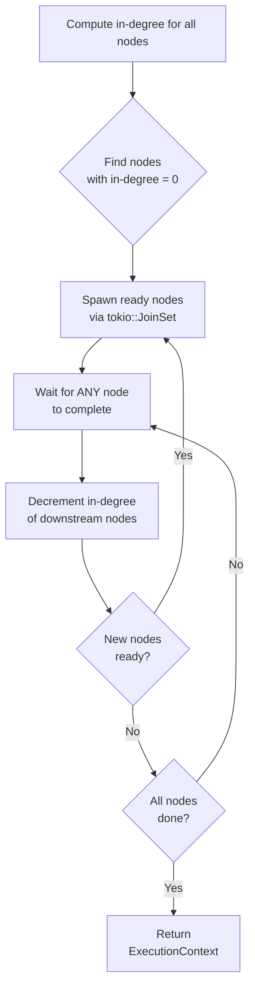

# DAG Execution

Sisyphus executes SOP graphs using a **parallel topological executor** based on in-degree tracking.

## Algorithm



## Parallelism Model

Nodes with no dependency relationship execute simultaneously:

```mermaid
gantt
    title DAG Execution Timeline
    dateFormat X
    axisFormat %s

    section Batch 1
    Node A (fetch)    : 0, 3
    Node B (validate) : 0, 2
    Node C (search)   : 0, 4

    section Batch 2
    Node D (process)  : 3, 3
    Node E (merge)    : 4, 2

    section Batch 3
    Node F (output)   : 6, 1
```



## Code: Core Executor

```rust
// Simplified from sisyphus-core::Executor
pub async fn execute_with_context(
    &self, sop_graph: &SOPGraph, start_node: NodeIndex, initial_ctx: Option<Arc<ExecutionContext>>,
) -> Result<Arc<ExecutionContext>, String> {
    // Validate acyclic
    toposort(&sop_graph.graph, None).map_err(|_| "SOPGraph contains cycles")?;

    let ctx = initial_ctx.unwrap_or_else(|| Arc::new(ExecutionContext::new()));
    let mut join_set = JoinSet::new();
    let mut in_degree: HashMap<NodeIndex, usize> = HashMap::new();

    // Initialize in-degree counts
    for node in sop_graph.graph.node_indices() {
        let degree = sop_graph.graph.edges_directed(node, Incoming).count();
        in_degree.insert(node, degree);
        if degree == 0 {
            let ctx = ctx.clone();
            let node = sop_graph.graph[node].clone();
            join_set.spawn(async move { node.execute(&ctx).await });
        }
    }

    // Process results as they complete
    while let Some(result) = join_set.join_next().await {
        let (node_id, output) = result.map_err(|e| format!("Join error: {}", e))??;
        // Store output in context
        ctx.set(&sop_graph.graph[node_id].name(), output).await;
        // Fan-out to downstream nodes
        for edge in sop_graph.graph.edges_directed(node_id, Outgoing) {
            let target = edge.target();
            let degree = in_degree.get_mut(&target).unwrap();
            *degree -= 1;
            if *degree == 0 {
                // Spawn the now-ready node
            }
        }
    }

    Ok(ctx)
}
```

## Error Handling

- **Cycle detection**: `toposort()` rejects cyclic graphs before execution begins
- **Node errors**: Propagated up; the cognitive loop catches them and evolves the SOP
- **Join errors**: Tokio task panics are caught and returned as errors

## Fuel & Memory

Each node executes with its configured fuel budget. Wasmtime's fuel metering tracks WASM instruction consumption. Exhaustion triggers `ResourceExhausted`, which the cognitive loop uses to adjust fuel for retries.
