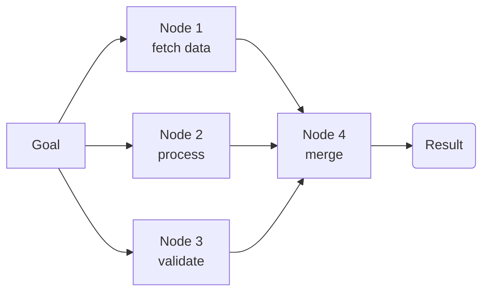
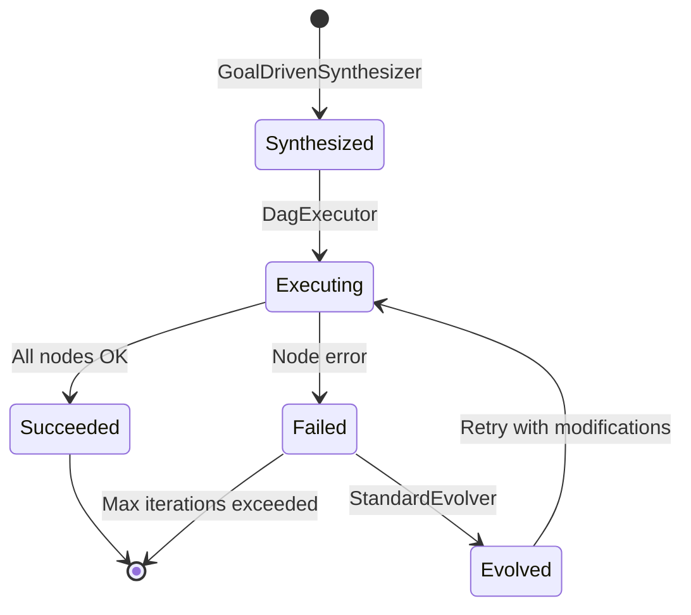

# Standard Operating Procedure (SOP)

An SOP is a **directed acyclic graph (DAG)** that represents a procedure to achieve a specific goal.

## Structure



Each node contains:
- **Name**: Unique identifier within the SOP
- **Description**: Semantic description of the step (used for synthesis and reflection)
- **Tool Type**: Which WASM tool binary to invoke
- **Fuel Budget**: WASM instruction limit for this node (default: 10,000)
- **Max Retries**: How many times to retry on failure
- **Timeout**: Maximum wall-clock time (default: 30s)

## Lifecycle



1. **Synthesize**: `GoalDrivenSynthesizer` generates an SOP graph from a natural-language goal
2. **Execute**: `Executor` runs the DAG with topological ordering — independent nodes in parallel
3. **Evolve**: After reflection, the SOP may be mutated — new nodes added, fuel budgets adjusted, or subgraphs restructured

## Evolution Operations

| Operation | Description |
|-----------|-------------|
| **Retry wrapper** | Wrap a failed node with retry logic (increased fuel) |
| **Fuel increase** | Boost fuel budget for nodes that exhausted fuel (2× per retry) |
| **Subgraph restructure** | Reorder or split nodes for better parallelism (future) |

## SOP Graph Config

```rust
pub struct SOPGraphConfig {
    pub max_concurrency: usize,      // Max parallel nodes (default: 16)
    pub default_fuel: u64,          // Default per-node fuel (default: 10,000)
    pub default_timeout_ms: u64,    // Default per-node timeout (default: 30,000)
    pub max_retries: u32,           // Default retries per node (default: 3)
}
```
