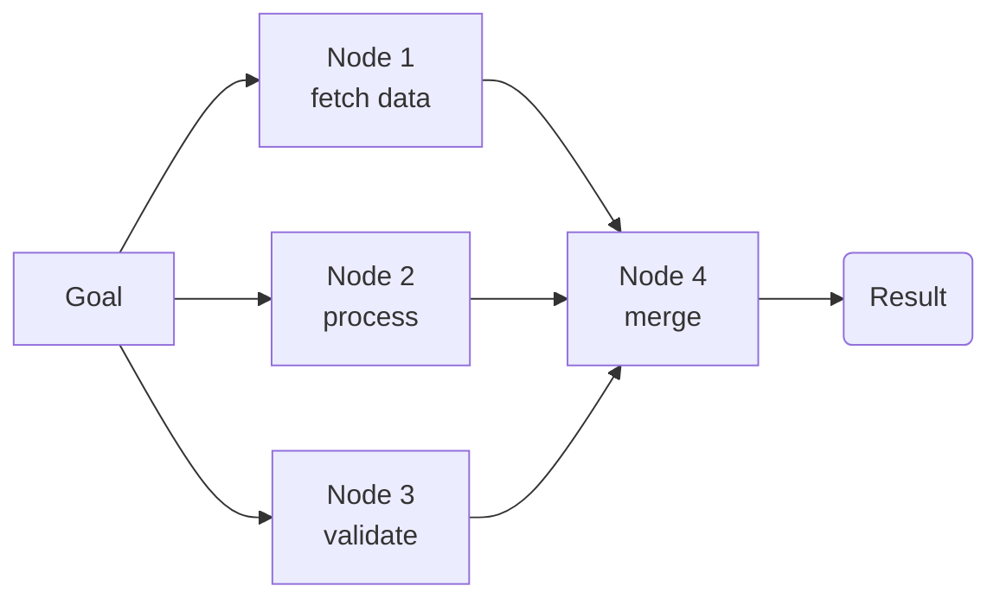
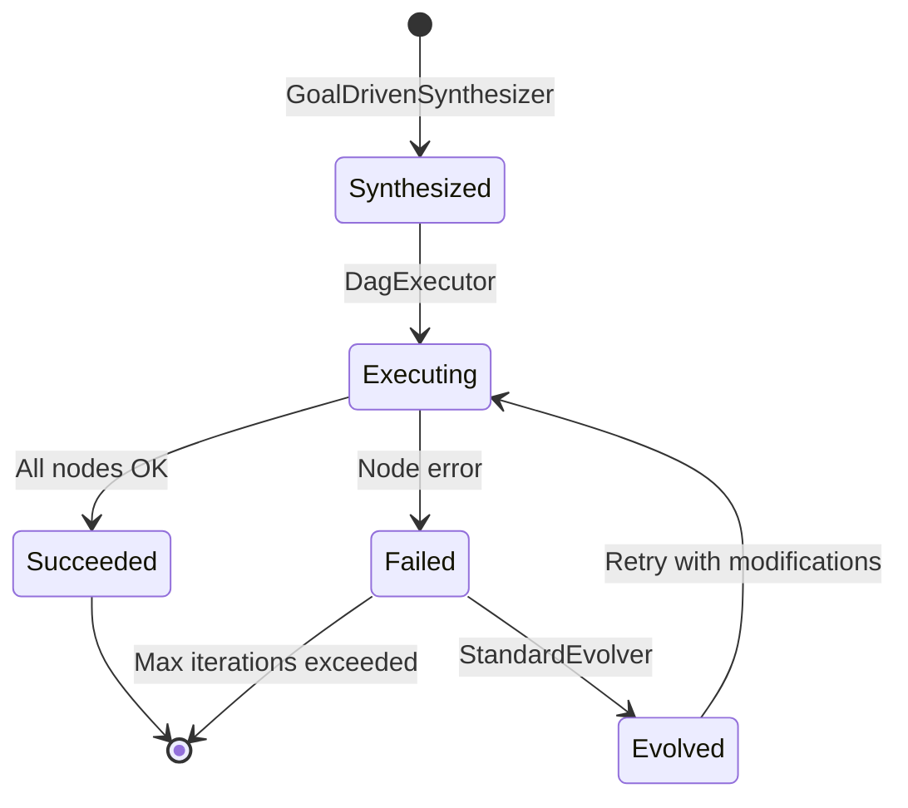

# SOP 编排

SOP 是一个**有向无环图**（directed acyclic graph，DAG），表示达成特定目标的过程。

## 结构



每个节点包含：
- **名称**（Name）：SOP 内的唯一标识符
- **描述**（Description）：步骤的语义描述（用于合成与反思）
- **工具类型**（Tool Type）：要调用的 WASM 工具二进制
- **燃料预算**（Fuel Budget）：该节点的 WASM 指令上限（默认 10,000）
- **最大重试次数**（Max Retries）：失败时重试次数
- **超时**（Timeout）：最大墙钟时间（默认 30s）

## 生命周期



1. **合成**（Synthesize）：`GoalDrivenSynthesizer` 从自然语言目标生成 SOP 图
2. **执行**（Execute）：`Executor` 按拓扑序运行 DAG，独立节点并行执行
3. **演进**（Evolve）：反思后 SOP 可能被变异，新增节点、调整燃料预算或重构图子图

## 演进操作

| 操作 | 说明 |
|-----------|-------------|
| **重试包装** | 为失败节点包装重试逻辑（增加燃料） |
| **燃料增加** | 为耗尽燃料的节点提升燃料预算（每次重试 2×） |
| **子图重构** | 重排或拆分节点以获得更好的并行性（未来） |

## SOP 图配置

```rust
pub struct SOPGraphConfig {
    pub max_concurrency: usize,      // 最大并行节点数（默认: 16）
    pub default_fuel: u64,          // 每节点默认燃料（默认: 10,000）
    pub default_timeout_ms: u64,    // 每节点默认超时（默认: 30,000）
    pub max_retries: u32,           // 每节点默认重试次数（默认: 3）
}
```